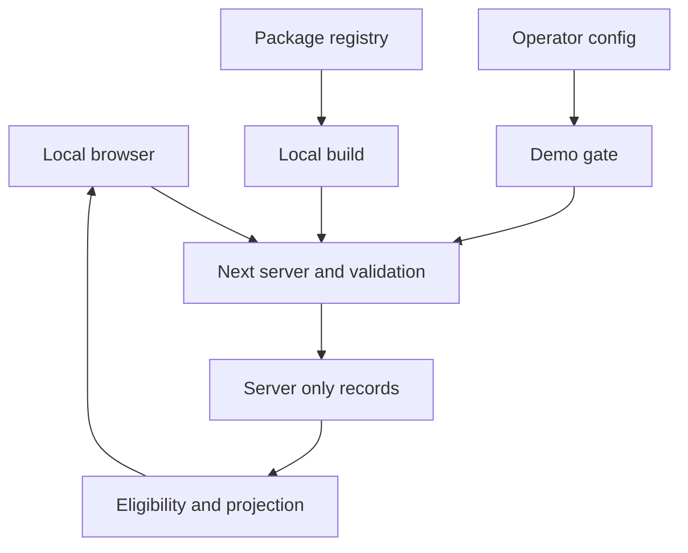

# Restored Healthy Homes — Phase 1 threat model

## Executive summary

This local read-only demo contains synthetic records. Main risks are future misuse of demo routes as authorization, accidental private-field serialization, and dependency/configuration drift. Live mode and Vercel production are blocked, public fields are explicitly projected, and no payments, sessions, uploads or database clients exist. This review does not certify the later product.

## Scope and assumptions

In scope: `src/`, Next config, scripts/lockfile, unit/browser tests. Vendored skills are development instructions, not runtime code. Original confidential documents stay outside served folders. Real Supabase/Stripe/email/hosting operations are out of scope.

The user explicitly confirmed local-only, fictional data, no credentials, read-only shells and no deployment. There are no unanswered context questions blocking this review. The user's instruction to ask only for blockers supersedes the skill's redundant context-confirmation pause. Reassess if exposure, data or adapters change.

## System model

### Primary components

Next.js server routes compose repository data into semantic UI. Small client modules handle menu and retry. `src/data/demo/fixtures.ts` and `repository.ts` are server-only. `assertDemoConfiguration` runs in Next config, root layout and adapters. Scripts bind to loopback.

### Data flows and trust boundaries

- Browser → server over local HTTP: category query is untrusted. `parseDirectoryQuery` bounds length, rejects arrays and checks IDs. No authentication or sensitive input is claimed.
- Repository → public rendering in-process: eligibility filter precedes explicit DTO projection; account/application/billing fields remain private. No external database boundary yet.
- Repository → demo dashboards: dedicated overview DTOs contain synthetic status only. No production authorization exists here; config blocks live use.
- Operator environment → runtime: server-only mode/scenario inputs are validated at build/start/request. Visitors cannot control these with URLs or localStorage.
- Registry/development guidance → workstation/build: exact package versions, lockfile and skill revisions support reproducibility, but third-party executable code remains trusted.

#### Diagram

## Assets and security objectives

| Asset | Why it matters | Objective |
| --- | --- | --- |
| Source documents | Confidential project/client details | Confidentiality |
| Future account data | Must never appear publicly | Confidentiality |
| Listing/category rules | Prevent unauthorized publication/billing drift | Integrity |
| Demo/live boundary | Prevent fake authorization becoming real access | Confidentiality/integrity |
| Workstation/build | Third-party executable dependencies | Confidentiality/integrity/availability |

## Attacker model

### Capabilities

A visitor who reaches localhost can send arbitrary URLs, repeat requests, follow demo links and inspect responses. A malicious dependency may execute at build/install. An operator can misconfigure packaging or mode.

### Non-capabilities

Ordinary visitors cannot alter server environment/files, approval, suspension or billing. No mutation endpoint, credential input, upload or authenticated account exists. Internet exposure and real PII are excluded; local OS compromise is outside app control.

## Entry points and attack surfaces

| Surface | Reach | Boundary | Notes | Evidence |
| --- | --- | --- | --- | --- |
| Home/directory | GET / and /directory | Browser/server | ID validation and JSX escaping | `src/app/directory/page.tsx`, `src/validation/directory.ts` |
| Demo shells | GET /demo/member and /demo/admin | Visitor/demo | Read-only synthetic states | `src/data/demo/repository.ts`, `src/features/dashboard/dashboard-shell.tsx` |
| Config | Build/start/request | Operator/runtime | Live/unknown/Vercel production denied | `src/domain/config.ts`, `next.config.ts` |
| HTML/RSC/assets | Framework responses | Server/browser | DTO allowlist; no static docs | `src/domain/listing.ts`, `.vercelignore` |
| Install/build | npm ci | Registry/workstation | Locked dependencies | `package.json`, `package-lock.json` |

## Top abuse paths

1. Request demo admin → attempt real access → only synthetic read-only projections exist. Real data added here without auth would create a vulnerability.
2. Change category URL → attempt hidden listing publication → central eligibility excludes it. Future webhooks must not write suspension.
3. Inspect HTML/RSC → attempt private-field extraction → allowlist projection excludes private fields. Future object spreading could regress this.
4. Supply script as category → validator rejects unknown ID; JSX escapes strings → no current raw HTML sink.
5. Run live build → config denies → operator would need to deliberately remove/replace safeguards. A mode flag cannot supply production readiness.
6. Request or publish correspondence → no static mapping and packaging exclusion → a generic file server/manual upload would defeat this protection.
7. Poison dependency → execute on workstation → locks/audit reduce drift but cannot sandbox a compromised release.

## Threat model table

| Threat ID | Source | Prerequisites | Action | Impact | Assets | Existing controls | Gaps | Recommendation | Detection | Likelihood | Severity | Priority |
| --- | --- | --- | --- | --- | --- | --- | --- | --- | --- | --- | --- | --- |
| TM-001 | Future developer/visitor | Real data replaces fixtures | Treat demo route as authorized | Cross-account access | Accounts | Demo routes, config guard | Real auth absent intentionally | Replace with server ownership, RLS and admin MFA | Anonymous/other-owner tests | Low now; requires code change | High with real data | low |
| TM-002 | Visitor/developer | Private props reach browser | Inspect responses | Data leak | Private fields | DTO allowlist, server-only modules | Future fields need discipline | Preserve projections and tests | HTML/RSC output tests | Low; no path found | Low now, high with PII | low |
| TM-003 | Visitor | Crafted category query | Inject script/bypass rules | UI integrity | Browser/listings | Validation, JSX, central eligibility | No script-src CSP yet | Add nonce policy before real user content | Malformed-query tests | Low; no unsafe sink | Low currently | low |
| TM-004 | Operator | Incorrect packaging/exposure | Publish docs or demo | Confidentiality/reputation | Sources/trust | Loopback, ignores, production gate, noindex | noindex is not access control | Keep exclusions; protected previews if authorized | Artifact/forbidden-path checks | Low; no deployment | High for sources | low |
| TM-005 | Supply chain | Compromised release | Execute at install/build | Workstation compromise | Source/build | Versions/lock, audit, provenance | No dependency sandbox | Review updates, least-privilege reproducible CI | Audit/update review | Low with trusted-registry assumption | High | medium |
| TM-006 | Visitor | Network reachability | Repeated render requests | Availability | Local server | Loopback, bounded inputs/dataset | No rate limiter | Edge limits before exposure/forms | Host metrics later | Low locally | Low | low |

## Criticality calibration

Critical: production credential theft or payment/admin takeover; these surfaces do not exist. High: confidential source publication or future cross-account disclosure. Medium: toolchain compromise or externally reachable render exhaustion. Low: synthetic data inspection or temporary local preview interruption. Real data and exposure materially increase rankings.

## Focus paths for security review

| Path | Reason | Threats |
| --- | --- | --- |
| `src/domain/config.ts` | Fail-closed boundary | TM-001/004 |
| `src/domain/listing.ts` | Public fields/eligibility | TM-002/003 |
| `src/data/demo/repository.ts` | No production auth claim | TM-001/002 |
| `src/validation/directory.ts` | Query parsing | TM-003/006 |
| `next.config.ts` | Headers/config | TM-003/004 |
| `package-lock.json` | Supply chain | TM-005 |
| `.vercelignore` | Confidential packaging | TM-004 |

## Notes on use

All discovered routes and browser/server/config/build boundaries are covered; runtime is separated from tooling and future services. No high/critical exploitable issue was identified in the current constrained review. Residual supply-chain risk remains. Follow architecture.md's future controls and re-run security tests when real services connect. This is not a penetration test.
