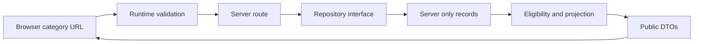

# Architecture

Scope is governed by the [overview](../Project%20overview/restored-healthy-homes-project-overview.md) and [alignment](../Project%20overview/client-conversation-alignment.md). This document describes implementation, not a second product scope.

## Boundaries

| Location | Responsibility |
| --- | --- |
| `src/app` | Routes, layouts, metadata, loading/error/not-found |
| `src/components/site` | Brand, navigation, footer |
| `src/components/ui` | Semantic buttons and notices |
| `src/features/directory` | Categories, cards and result states |
| `src/features/profiles` | Public profile presentation, request-scoped lookup and local inquiry interaction |
| `src/features/dashboard` | Shared workspace shell |
| `src/features/admin` | Local review, filters, category labels and projected session directory |
| `src/features/member` | Shared tab-local session, application/editor form and demo workspace |
| `src/domain` | Catalog, types, eligibility/projection and config policy |
| `src/data` | Async contracts/server adapters; separate client-safe synthetic member fixtures |
| `src/validation` | Query, safe return, inquiry and shared application/edit validation |
| `tests/unit`, `tests/e2e` | Business invariants and browser journeys |

Routes are Server Components. Menu disclosure, error retry, search history restoration and local demo inquiry interactions use small client islands. Native GET/select and details controls work without a client state framework. Layouts compose children. Tailwind v4 supplies the CSS pipeline/tokens; named component styles express the design. shadcn primitives are deferred until needed.

## Data flow

Category queries use stable IDs. PublicProfessional and toPublicProfessional positively enumerate public fields; never spread a private record into props. Dashboard DTOs expose only synthetic overview fields, not raw account/application/billing records.

No persistence exists. Directory fixtures are server-only; tests use the react-server condition without disabling that boundary. Separate synthetic member DTOs are safe to bundle for the local demo session; they contain no private server account/billing/application records. Dynamic rendering runs the demo config guard at request time as well as build/start. A server-only `RHH_DEMO_SCENARIO=error` switch tests adapter failure; visitors cannot set it through URL parameters. Invalid/repeated/oversized query values produce correction errors. Adapter errors render retry guidance without serializing exceptions.

Phase 2A replaces invalid-query empty states with field-linked correction errors. `DirectoryRepository.search` obtains eligible public projections before calling `searchEligiblePublic`; `LocationAdapter` provides the replaceable city/ZIP resolver. Pure keyword/location/radius/sort/pagination rules receive only public records. Search state lives in validated canonical URLs, not client storage. See [Phase 2A query contract and limitations](phase-2a-handoff.md).

## Identity and rules

Phase 2C-2 extends the root React session provider for applications, member edits and admin decisions. The domain reducer is the only shared state writer and explicitly copies permitted fields. Reset clones the synthetic baseline and restores category labels; refresh or full-document navigation creates a new session. There is no server mutation, browser storage or role-based authorization. Forms stay disabled until hydration. The obsolete server dashboard getters/contract/roster DTO have been removed. See [Phase 2C-2 handoff](phase-2c2-handoff.md).

Credential objects (`id`, `text`, `verification`) are canonical on each session record. Form text is derived from them; exact unchanged claims preserve identity across reordering, while new/changed/re-added claims receive new IDs and unverified status. Applicant-facing review reasons are protected from member edits and excluded from explicit public projections, along with application contact name/email. The admin directory applies eligibility before projection; the member preview may show its own ineligible content without publication. Session category names overlay canonical immutable IDs; prices and billing mappings never enter rename actions.

Phase 2D adds validated URL sections/filters/selection through `src/validation/dashboard.ts`. The shared shell renders persistent desktop navigation and native mobile disclosures; Next links preserve the root provider. Draft text is held separately from accepted records in that same provider, keyed by form purpose and record/category ID. Forms validate drafts before dispatching existing reducer actions. Reset clears accepted changes and drafts together. `DecisionForm` serves application/listing decisions, with one credential-review component and one category editor. The business reducer and eligibility/public projections retain their existing behavior. See [Phase 2D handoff](phase-2d-handoff.md).

Phase 2B adds `DirectoryRepository.getPublicProfile`: eligibility precedes the explicit `PublicProfile` projection, including a nested contact allowlist independent of private account email. Page and metadata share a request-scoped cached lookup; missing/ineligible IDs invoke the same not-found boundary. Only the inquiry form is interactive, with shared validation and transient browser state; no handler, server action, persistence or logging receives its contents. Return links accept only `/directory` with validated search parameters. See [Phase 2B handoff](phase-2b-handoff.md).

Category ID, display name, base price and billing key are separate. Billing keys are internal mappings, not Stripe price IDs. Renaming must never change identity or billing. ID arrays allow multi-category membership; a later relational junction preserves this. No combined-price calculation exists.

Approval, subscription, suspension, credential verification and featured entitlement are independent. Public eligibility requires approved + active + no suspension. Featured eligibility also requires active entitlement. The October 21 admin showcase adds simulated membership/entitlement commands and a separate eligible featured preview, with no payment or public search ranking change. Only verified credential names are projected in production-shaped public DTOs; the explicit demo preview separately labels submitted credential claims.

## Future integration/security

The [admin completion follow-up](admin-completion-handoff.md) extends the session catalog with generated IDs/separate billing mappings and adds category-scoped education drafts/publication. Optional public name/email fields never default from application contacts. Published-only resource/certification selectors feed small public islands; static page shells and original public reference adapters remain server-rendered. Session-created resource IDs use neutral no-index HTML, with availability resolved from tab state; other missing resource slugs still return 404. No production authentication or persistence is introduced.

The [admin workflow showcase](admin-showcase-handoff.md) adds shared listing edits, simulated memberships/featured entitlements, draft/review/publish resource previews, session activity and derived analytics. `src/domain/admin-showcase.ts` holds typed commands and calculations; `src/validation/admin-showcase.ts` validates editorial input. The existing reducer remains the sole accepted-state writer. Its activity wrapper records accepted admin changes only. No production auth/data service is implied; the handoff maps the future server boundary and preserves the deferred integration requirements.

Replace adapters at `src/data/index.ts`. Build authenticated owner/admin services rather than turning demo interfaces into production access.

- Supabase: separate public profile, account, application, inquiry and billing data; use stable IDs and indexed category relations. Migrations and SQL tests come later.
- Verify sessions server-side and enforce ownership/privileges on every read/write. Admin MFA, revocation, least privilege and audit logs; never trust editable user metadata for roles.
- Enable RLS and explicit grants on exposed tables. Test anonymous, owner, other-member, suspended and admin access. Review view security/storage separately. [Supabase API guidance](https://supabase.com/docs/guides/api/securing-your-api).
- Runtime validation at external boundaries. Upload limits, signature/type checks, safe filenames, image re-encoding, active-content rejection, private storage and signed links.
- Bound/rate-limit public forms; add spam controls and CSRF/origin protection for cookie-authenticated mutations. No raw HTML rendering.
- Stripe: verify signatures on raw webhook bodies, idempotency, event order, amount/currency/price mappings. Never publish from a client success redirect; payment cannot lift suspension.
- Redact secrets/PII in logs; add request/audit IDs, privileged-change monitoring, retention and recovery plans.
- Expand the current framing/base/object/form CSP into a nonce-based script policy before real untrusted content/integrations. Current headers are not a complete script-src policy.

No service-role credentials belong in the browser. Re-run threat modeling and real authorization/storage/payment security tests when services connect.

## Phase 2E-1 Q&A boundary

Public Q&A routes use `QaRepository` and server-only fixtures, with publication gates before explicit projections and search/counts. Only question submissions created in this tab enter the existing demo reducer; their status is forced to pending. The shared draft mechanism stores unfinished question fields in React memory. No hidden Q&A seed or moderation note is imported into the provider. The [2E-1 handoff](phase-2e1-handoff.md) records the public query contract and the planned session overlay for later moderation.
